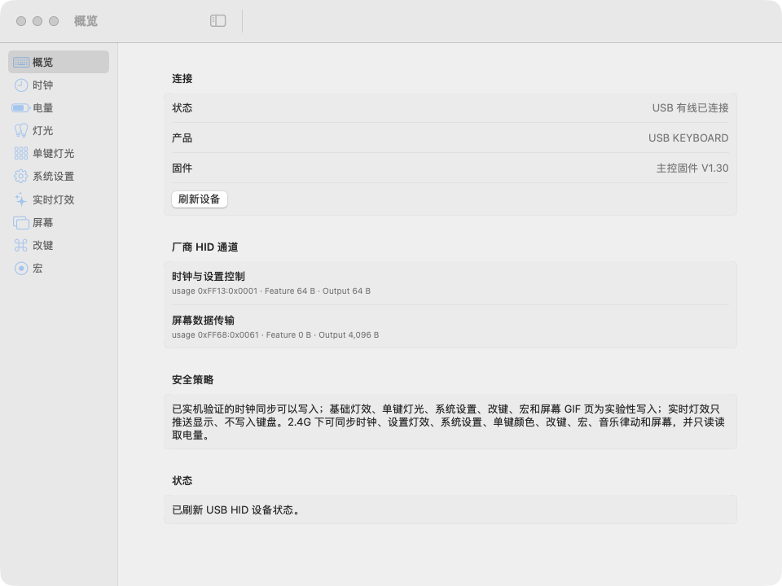

# AK35i Control Center：AJAZZ AK35i V3 Max 的 Mac 控制软件

[](https://github.com/Ike-li/ak35i-v3-max-macos-control-center/actions/workflows/ci.yml)
[](https://github.com/Ike-li/ak35i-v3-max-macos-control-center/releases)
[](LICENSE)

[English](README.en.md) · [下载](https://github.com/Ike-li/ak35i-v3-max-macos-control-center/releases) · [快速上手](docs/GETTING_STARTED.md) · [中英文说明书](docs/manuals/) · [故障排查](docs/TROUBLESHOOTING.md) · [功能状态](docs/PROTOCOL_STATUS.md)

**AK35i Control Center** 是 **AJAZZ AK35i V3 Max**（三模带屏机械键盘）的非官方 macOS 原生控制软件和命令行工具。官方驱动只有 Windows 版，它让你在 Mac 上完成驱动里的大部分设置：RGB 灯效、单键颜色、改键、宏、屏幕时钟、屏幕 GIF、电量，以及驱动原版的实时灯效和音乐律动。支持 USB 有线和 2.4G 接收器，蓝牙下可读电量。

> Unofficial native macOS app and CLI for the **AJAZZ AK35i V3 Max** keyboard, a Mac alternative to the Windows-only vendor driver: RGB lighting, per-key colours, key remapping, macros, screen clock and GIF upload, battery level, realtime effects and a music visualiser, over USB and the 2.4G receiver. Independent community project, not affiliated with, endorsed by, or supported by AJAZZ. See [NOTICE.md](NOTICE.md).



## 功能

| 功能 | 控制中心 | 命令行示例 |
|---|---|---|
| 屏幕时钟同步（UTC+8 或 Mac 当前时区） | “时钟”页 | `ak35i time sync --utc8 --apply` |
| 基础灯效：20 种模式及亮度、速度、方向、颜色 | “灯光”页 | `ak35i light set --mode 1 --color 00FF00 --apply` |
| 单键颜色（可读回） | “单键灯光”页 | `ak35i keys set Esc=FF0000 --apply` |
| 系统设置：禁用 Win / Alt+Tab / Alt+F4、休眠、响应时间、Fn 开关 | “系统设置”页 | `ak35i system set` |
| 改键（普通层与 Fn 层，含媒体键、鼠标键） | “改键”页 | `ak35i keymap set CapsLock=Esc --apply` |
| 宏（绑定为 `macro:N`） | “宏”页 | `ak35i macro set "Cmd+Space, 100ms, A" --apply` |
| 屏幕 GIF 页上传（图片或 GIF，16:9） | “屏幕”页 | `ak35i screen set 图片.gif --apply` |
| 实时灯效：Windows 驱动原版的 8 种效果，由 Mac 逐帧推送 | “实时灯效”页 | `ak35i live wave` |
| 音乐律动：按驱动原版算法随 Mac 播放的声音变化 | “实时灯效”页 | `ak35i live music` |
| 电量（2.4G 或蓝牙）、固件版本 | “电量”“概览”页 | `ak35i battery`、`ak35i status` |

屏幕时钟已验证，其余写入为实验性，详见 [功能与协议状态](docs/PROTOCOL_STATUS.md)。

## 兼容性

| 项目 | 说明 |
|---|---|
| 键盘 | AJAZZ AK35i V3 Max 三模带屏版，USB VID:PID `0C45:8009`，已验证固件 V1.30 |
| 连接 | USB 有线：全部功能。2.4G 接收器：除逐键实时灯效和读回单键颜色外都可用。蓝牙：只能读电量（键盘在蓝牙下不接受设置命令，用接收器或数据线写入的设置切回蓝牙后仍保留） |
| 系统 | macOS 13+，Intel 与 Apple Silicon 通用；音乐律动需要 macOS 14.2+ |
| 隐私 | 无账号、遥测或上传；不显示、保存或写入设备序列号 |

## 下载安装

1. 从 [Releases](https://github.com/Ike-li/ak35i-v3-max-macos-control-center/releases) 下载最新的 `universal.dmg` 与同名 `.sha256` 校验文件。
2. 打开 DMG，将 **AK35i Control Center** 拖到“应用程序”。
3. 首次打开：应用没有 Apple 开发者签名和公证，macOS 会阻止。点“完成”，再到“系统设置 › 隐私与安全性”点“仍要打开”并输入登录密码，只需一次。macOS 14 及更早版本也可以按住 Control 点按应用，选“打开”。
4. 用数据线（USB 档）或 2.4G 接收器连接键盘，在“概览”页确认已连接。

完整步骤、连接方式对照、权限说明与 CLI 用法见 [快速上手](docs/GETTING_STARTED.md)。

## 为什么功能没有全开？

屏幕时钟已经经过真机验证。基础灯效的写入序列已在实机上取得“报文 → 设备确认 → 效果 → 重连后保留”的证据，但目前只看过静态恒亮和川流不息两种模式，因此标为实验性；写错时可以用键盘的 `Fn+\|` 等快捷键恢复。系统设置、改键和宏同样有实机证据并标为实验性，键盘读不回这三项，但都能写回默认值或清空。屏幕 GIF 页上传也已实机验证，断电后保留，按 `Fn+PrtSc` 查看、再按返回主页面；但覆盖后原内容无法恢复（出厂开机动画不受影响）。电量经 2.4G 接收器或蓝牙读取，都已实机验证；有线 USB 下键盘不提供（Windows 驱动和固件分析一致）。程序不会猜测 opcode，也不会盲发写入。

这是刻意的安全边界，不是界面遗漏。详见 [功能与协议状态](docs/PROTOCOL_STATUS.md) 与 [安全模型](docs/SAFETY_MODEL.md)。

## 从源码构建

需要 Xcode/Swift 6 与 macOS 13+：

```zsh
git clone https://github.com/Ike-li/ak35i-v3-max-macos-control-center.git
cd ak35i-v3-max-macos-control-center

swift test --disable-sandbox
./Packaging/build-app.sh
open "dist/AK35i Control Center.app"
```

创建本地 DMG：

```zsh
./Packaging/create-dmg.sh
```

`create-dmg.sh` 生成 Intel 与 Apple Silicon 通用的 DMG。本地构建和发布包都是 ad-hoc 签名，没有经过 Apple 公证，首次打开的方法见上文。

## 文档导航

| 你想做什么 | 文档 |
|---|---|
| 首次安装、同步时间或使用 CLI | [快速上手](docs/GETTING_STARTED.md) |
| 区分型号，查看 V3 Max 中英文说明书入口与快捷键 | [中英文说明书](docs/manuals/) |
| 处理 Gatekeeper、找不到设备等问题 | [故障排查](docs/TROUBLESHOOTING.md) |
| 了解已验证与锁定功能 | [功能与协议状态](docs/PROTOCOL_STATUS.md) |
| 理解为何不猜测私有 HID 命令 | [安全模型](docs/SAFETY_MODEL.md) |
| 参与开发或提交协议证据 | [贡献指南](CONTRIBUTING.md) |
| 维护发布包 | [发布流程](docs/RELEASING.md) |
| 驱动来源、静态逆向记录 | [技术文档](docs/) |

## 常见问题

**AJAZZ AK35i V3 Max 能在 Mac 上用吗？**
键盘插上就能打字。官方设置软件只有 Windows 版，本项目在 Mac 上提供其中的大部分设置。

**和官方 Windows 驱动有什么不同？**
报文按驱动逆向复现，只发送驱动发过的命令。不提供固件升级和恢复出厂；屏光联动、配置导出与导入还没有实现。

**2.4G 和蓝牙能用吗？**
2.4G 接收器下可以使用大部分设置。蓝牙下键盘不接受设置命令，只能读电量。

**会不会把键盘弄坏？**
程序不猜测命令，也不处理固件。灯效可用键盘快捷键恢复，改键和宏可以写回默认或清空；屏幕上传会覆盖 GIF 页原内容，出厂开机动画不受影响。见 [安全模型](docs/SAFETY_MODEL.md)。

**支持其他 AJAZZ 键盘吗？**
只在 AK35i V3 Max（USB `0C45:8009`）上验证过。AK820、AK35i V3 Pro 等型号的协议可能不同，不要用本程序对它们写入。

**为什么第一次打不开？**
应用没有经过 Apple 公证，需要在“系统设置 › 隐私与安全性”里点“仍要打开”，见 [快速上手](docs/GETTING_STARTED.md)。

## 参与贡献

欢迎提交 bug、文档和可复现的协议证据。开始前请阅读 [CONTRIBUTING.md](CONTRIBUTING.md)。请勿在 issue、日志、截图或抓包中公开设备序列号、私人图片或未脱敏的个人路径。

## 许可与声明

代码以 [MIT License](LICENSE) 发布。型号、商标和第三方材料边界见 [NOTICE.md](NOTICE.md)。本仓库不包含、分发或修改厂商 Windows 驱动、固件、图片、GIF 或源码；为复现驱动的实时灯效和键位，收录了从驱动中取出的少量数值表和键位数据，详见 NOTICE。
